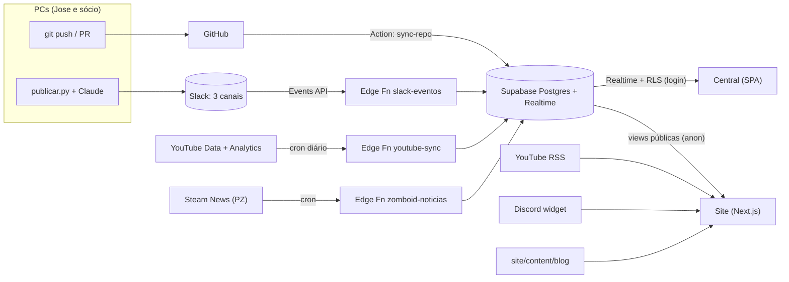

# Plataforma — arquitetura

Duas entregas, nesta ordem:
1. **Central** (`plataforma/`): sistema interno do Jose e do sócio.
2. **Site** (`site/`): landing imersiva + blog público do canal.

Plano de etapas e chaves: `plataforma/plano.md`.

## 1. Princípios
- **Cada dado tem um dono.** A Central lê; só edita o que nasce nela.
- **Slack é o barramento de eventos.** A pipeline já avisa tudo no Slack; a Central escuta. Nenhuma mudança nos PCs.
- **Regra nº 1 vale no site.** Fato do jogo só de `info-validada/`. Post que cita fato fora dela não builda.
- **Segredo nunca no git.** Ficam em Supabase Secrets, GitHub Secrets ou na hospedagem.
- **Custo zero no início.** Tudo em plano grátis; nada pago sem o Jose aprovar.

| dado | dono (fonte da verdade) | Central |
|---|---|---|
| episódio, tema, status, responsável, fatos | repo: cabeçalho de `roteiros/epNN-*.md` | só leitura |
| prévias e finais (link, versão, autor) | Slack: mensagens do `publicar.py` | só leitura |
| atualizações do GitHub | Slack `#atualizações-projeto` | só leitura |
| tarefas, notas, relatórios | Supabase | edita |
| métricas dos Shorts | YouTube (APIs) | só leitura |
| notícias do Zomboid | Steam News → fila | aprova / descarta |
| posts do blog | repo: `site/content/blog/*.mdx` (PR) | — |

## 2. Visão geral


## 3. Central (`plataforma/`)
### Stack
- **App:** Vite + React + TypeScript (SPA estática; servidor = Supabase).
- **UI:** Tailwind com os tokens da marca, componentes próprios estilo HUD, Recharts nos gráficos.
- **Dados:** `@supabase/supabase-js` + TanStack Query; Realtime no feed.
- **Login:** Supabase Auth com **GitHub** (os dois já têm conta). Cadastro fechado: só quem está em `membros`.
- **Hospedagem:** Cloudflare Pages (grátis, prévia por PR).

### Telas
| tela | o que mostra |
|---|---|
| **Painel** | episódios por status (quadro), próximas postagens (seg/qua/sex), últimos alertas, tarefas abertas |
| **Episódios** | lista + ficha: status, responsável, build, fatos, prévias (v1, v2...), final + capa, vídeo no YouTube, métricas |
| **Prévias e finais** | linha do tempo de entregas, com player do Drive e filtro por episódio/pessoa |
| **Ao vivo** | feed do Slack em tempo real (3 canais), filtros por canal |
| **Métricas** | tabela de `canal/metricas.md` automática, gráficos por vídeo/tema, relatório quinzenal |
| **Tarefas** | quadro a-fazer / fazendo / feito, por pessoa e episódio |
| **Notícias PZ** | fila de patch notes da Steam: resumir em PT-BR, pôr build e fonte, aprovar para o site |

### Pastas
```
plataforma/
  arquitetura.md, plano.md
  app/                    # SPA (Vite)
  supabase/
    migrations/           # SQL versionado (RLS incluso)
    functions/
      slack-eventos/      # recebe eventos do Slack
      youtube-sync/       # métricas diárias
      zomboid-noticias/   # busca notícias do PZ
  scripts/
    sync_repo.py          # roteiros/ + videos/README.md -> episodios
```

### Banco (Supabase Postgres)
| tabela | campos principais | quem escreve |
|---|---|---|
| `membros` | user_id, nome, github, papel | Jose (1x) |
| `episodios` | nn, slug, tema, responsavel, status, build, fatos[], youtube_id, commit | `sync_repo.py` |
| `entregas` | ep, tipo (previa/final/capa), versao, link, autor, duracao, slack_ts | `slack-eventos` |
| `alertas` | canal, tipo, texto, autor, slack_ts (único), criado_em | `slack-eventos` |
| `metricas_diarias` | youtube_id, dia, views, retencao_media, inscritos, origem... | `youtube-sync` |
| `relatorios` | periodo, conteudo, criado_por | Central |
| `tarefas` | titulo, ep, responsavel, status, prazo, ordem | Central |
| `noticias_pz` | url, titulo_original, data, build, resumo_ptbr, status, aprovado_por | `zomboid-noticias` + Central |
| views `pub_*` | vídeos publicados, notícias aprovadas | leitura anônima (site) |

- **RLS em tudo.** Membro lê e escreve o que é da Central; funções usam a service role; anônimo só lê `pub_*`.
- **Ligação vídeo ↔ episódio:** campo novo `youtube:` no cabeçalho do roteiro, preenchido ao publicar. O repo continua dono.

### Fluxos
- **Episódios:** push na `main` → GitHub Action roda `sync_repo.py` → upsert em `episodios`.
- **Prévias/finais + Ao vivo:** mensagem no Slack → `slack-eventos` (confere assinatura) → grava `alertas` e, se for 🎬/✅ do `publicar.py`, grava `entregas` → Realtime atualiza a tela.
  - Na primeira vez: importa o histórico dos 3 canais.
- **Métricas:** cron diário → `youtube-sync` → `metricas_diarias`. Relatório quinzenal gerado na Central (mesma tabela de `canal/metricas.md`).
  - Métrica que a API não der (ex.: "viewed vs swiped away"): campo manual, sem inventar.

## 4. Site (`site/`)
Stack, estrutura da landing e metas de qualidade: skill `manual-zomboid-landing-blog`. Resumo técnico:
- **Next.js + TypeScript + MDX**, quase tudo estático; rebuild agendado 1x/dia (vídeos e notícias novos).
- **3D:** React Three Fiber + drei + postprocessing, reaproveitando `projeto/assets/pz` e o `PZ.SOBREVIVENTE`. Carrega sob demanda, com imagem de fallback.
- **Movimento:** GSAP + ScrollTrigger, Lenis. `prefers-reduced-motion` desliga.
- **Vídeos:** RSS público do canal no YouTube (sem chave) + lite-youtube-embed.
- **Discord:** convite + widget oficial do servidor.
- **Atualizações do Zomboid:** só notícias **aprovadas** na Central (`pub_noticias`), cada uma com build e fonte.
- **Blog:** `site/content/blog/*.mdx`, cabeçalho com `build`, `fontes`, `video` e `fatos: [ids]`. Checagem no build: todo id existe em `projeto/pipeline/fatos.json`, nenhum termo de `_nao-usar.md`.
- **SEO:** next/og por post, RSS, sitemap, schema.org `VideoObject` e `BlogPosting`.
- **Hospedagem:** Cloudflare (mesma conta da Central); domínio quando o Jose comprar.

### Assets do jogo no site
- Liberado (decisão do Jose, skill do site): imagens, ícones, telas e modelos do jogo.
- **Não liberado:** sons e músicas do jogo. Site sem áudio do jogo.
- Só entra a lista curada (`site/assets.json`), copiada de `projeto/assets` no build. Nunca a pasta inteira.
- O `README.md` diz "nunca publique" os assets: precisa de uma linha com essa exceção (etapa S1).

## 5. Riscos e cuidados
| risco | cuidado |
|---|---|
| Cota do Git LFS (10 GiB/mês) gasta no CI | CI baixa só os arquivos da lista curada (`git lfs pull --include`) + cache |
| Parser das mensagens do Slack quebra se o modelo mudar | parser testado com as mensagens reais; mensagem não reconhecida vira só alerta |
| Supabase grátis pausa sem uso | cron diário mantém ativo; aviso se pausar |
| Dado do jogo errado no site | mesma trava dos vídeos (fatos.json) + revisão por PR |
| Prévia vaza (link "qualquer pessoa com o link") | Central atrás de login; site nunca mostra prévia |
